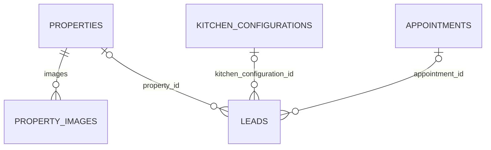

# MHG backend core — Fase 3A

FastAPI + SQLAlchemy 2.1 + Pydantic 2 + PostgreSQL 17 + Alembic.
Monolito modular con autenticación administrativa propia y sesiones revocables.
Las rutas públicas y administrativas están separadas; toda operación administrativa
se autoriza en FastAPI con un usuario persistido en PostgreSQL. No hay servicios externos
ni notificaciones en esta fase.

## Arranque con Docker Compose (PowerShell)

Requisitos: Docker Desktop con motor Linux operativo y Compose v2 o posterior.
En Windows se necesita WSL 2 o un backend de virtualización compatible ya configurado.
Estos comandos no instalan ni cambian componentes del sistema.

Desde la raíz del repositorio:

```powershell
cd backend
if (!(Test-Path .env)) { Copy-Item .env.example .env }
# Edita .env: establece DB_PASSWORD para tu entorno local.
docker compose config --quiet
docker compose up --build -d
docker compose ps
docker compose exec api alembic current
docker compose exec api alembic check
docker compose exec api python -m app.scripts.create_admin
Invoke-RestMethod http://localhost:8000/health
Invoke-RestMethod http://localhost:8000/api/v1/properties
```

No sobrescribas un .env existente. La API escucha en 127.0.0.1:8000 y PostgreSQL en
127.0.0.1:5432 del host; dentro de Compose usa db:5432. API_PORT y POSTGRES_PORT
permiten cambiar los puertos del host. Los puertos no se publican en interfaces externas.

El healthcheck espera a PostgreSQL; migrate ejecuta Alembic hasta head y solo después
arranca api. No hay create_all ni generación automática de esquemas al atender requests.
Una base recién creada tiene cero propiedades: no se insertan datos demo automáticamente.

```powershell
docker compose logs --tail=100 api migrate db
docker compose exec api alembic current
docker compose exec api alembic check
docker compose down
```

down conserva el volumen postgres-data. No usar down -v con datos que deban conservarse.
Cambiar DB_PASSWORD después de inicializar el volumen no cambia automáticamente la
contraseña del rol existente en PostgreSQL. Gestionar ese cambio explícitamente.
El comando create_admin solicita email, nombre y contraseña mediante una terminal
interactiva; la contraseña no se pasa como argumento ni queda guardada en Git. Para
crear personal de consulta, agregar `--role staff`. No existe registro público.

## Tests reproducibles con PostgreSQL aislado

Desde backend/, con .env ya configurado:

```powershell
docker compose --profile test run --build --rm tests
```

Este comando solo necesita test-db, no el API ni la base de desarrollo. test-db usa una
base mhg_test, credenciales descartables explícitas y tmpfs; no tiene puerto de host.
Los tests aplican la migración, comparan metadata con Alembic y aíslan cada caso
mediante transacción externa/savepoints. Nunca usan SQLite ni omiten silenciosamente
una base inaccesible. El nombre debe terminar en _test para evitar apuntar a datos reales.
Al terminar: docker compose --profile test stop test-db.

Para validar reversibilidad en esa base de pruebas descartable:

```powershell
docker compose --profile test run --rm tests alembic downgrade base
docker compose --profile test run --rm tests alembic upgrade head
docker compose --profile test run --rm tests alembic check
docker compose --profile test run --rm tests
```

El downgrade elimina las tablas y sus datos. Estos comandos se ejecutan en el servicio
tests, que tiene configuración fija para mhg_test; no ejecutarlos sobre datos reales.

## Desarrollo Python sin contenedores

Python 3.13. PostgreSQL operativo sigue siendo obligatorio para integración.
Desde backend/:

```powershell
python -m venv .venv
.\.venv\Scripts\python.exe -m pip install --require-hashes -r requirements-dev.txt
.\.venv\Scripts\python.exe -m pytest tests/test_contracts.py
.\.venv\Scripts\ruff.exe check app migrations tests
.\.venv\Scripts\ruff.exe format --check app migrations tests
.\.venv\Scripts\python.exe -m compileall -q app migrations tests
.\.venv\Scripts\alembic.exe upgrade head
.\.venv\Scripts\uvicorn.exe app.main:app --host 127.0.0.1 --port 8000
```

Configura las variables DB_* en .env para la base local. Para ejecutar tests de
integración contra PostgreSQL externo a Compose, utiliza una base descartable *_test:

```powershell
$env:DB_HOST="127.0.0.1"
$env:DB_PORT="5432"
$env:DB_NAME="mhg_test"
$env:DB_USER="mhg_test"
# Establece DB_PASSWORD localmente, sin guardarlo en archivos trackeados.
.\.venv\Scripts\python.exe -m pytest tests/integration
```

Las sesiones y migraciones usan UTC y connect_timeout=5. La API devuelve fechas ISO
con zona; las entradas de citas sin offset horario se rechazan.

requirements*.txt fijan dependencias transitivas con SHA-256. requirements*.in fijan
las dependencias directas. Docker fija Python 3.13.13 y PostgreSQL 17.11 por digest.
Para actualizar locks intencionalmente, usar Python 3.13 y pip-tools==7.6.1:

```powershell
.\.venv\Scripts\pip-compile.exe --strip-extras --generate-hashes --output-file requirements.txt requirements.in
.\.venv\Scripts\pip-compile.exe --strip-extras --generate-hashes --output-file requirements-dev.txt requirements-dev.in
```

Revisar los cambios de versiones/hashes y volver a ejecutar la suite en Linux.
Actualizar las imágenes periódicamente requiere revisar sus nuevos digests.

## Arquitectura y datos

```text
backend/
  app/
    main.py                 # composición, CORS, logging, health
    config.py               # env
    db.py                   # engine y sesiones
    common.py               # UUID, timestamps, schemas compartidos
    dependencies.py         # DB, sesión actual y autorización por rol
    errors.py               # respuestas de error consistentes
    models.py               # registro de modelos Alembic
    auth/                    # usuarios, sesiones, Argon2id y endpoints login/logout/me
    admin/                   # lecturas administrativas para el panel
    properties/             # models.py, schemas.py, router.py
    kitchen_configurations/ # models.py, schemas.py, router.py, submissions.py
    appointments/           # models.py, schemas.py, router.py, service.py
    leads/                  # models.py, schemas.py, router.py, service.py
  migrations/
    env.py
    versions/0001_core.py
    versions/0002_admin_auth.py
  tests/
    test_contracts.py
    integration/
  examples/
  Dockerfile
  compose.yaml
  alembic.ini
  requirements*.in / requirements*.txt
  .env.example
```

- admin_users: UUID, email único normalizado, hash Argon2id, nombre, rol admin/staff,
  actividad, último acceso y timestamps. No almacena contraseñas en texto plano.
- admin_sessions: guarda únicamente SHA-256 del token opaco aleatorio; la cookie real es
  HttpOnly, expira y se revoca al cerrar sesión. auth_login_limits mantiene presupuestos
  compartidos de intentos por email e IP.

- properties: UUID; slug único; status draft/published/archived; operation sale/rent;
  property_type house/apartment/land, alineado con el contrato actual del frontend;
  title, description, Numeric(14,2) price, currency ISO de tres letras; location
  {city,state,neighborhood}; features {area_m2,bedrooms,bathrooms,parking_spaces};
  latitud/longitud opcionales y timestamps.
- property_images: N filas por propiedad; URL, alt, dimensiones, posición única
  por propiedad y object_key opcional reservado para almacenamiento futuro.
  Solo acepta rutas propias o HTTPS; no descarga imágenes ni recibe archivos.
- kitchen_configurations: conceptos independientes de índices de pantalla;
  interior_board, exterior_fronts, hardware, countertop, finish y extras admiten
  snapshots JSON. selection_version y selections preservan el contexto completo.
  Incluye situación, dirección, coordenadas, sucursal, asesor, fecha solicitada y notas.
  No recalcula precios ni considera confiables los importes enviados por el cliente.
- appointments: fecha solicitada con zona, fecha confirmada opcional, sucursal,
  dirección, coordenadas, notas y estado. Una solicitud NO reserva disponibilidad.
- leads: source, name, phone, email/message opcionales, status
  new/contacted/qualified/closed, tres FK opcionales.



No hay FK directa entre cocina y cita: quedan relacionadas mediante el lead.
Un lead puede ser general, de propiedad, de cocina o reunir varias referencias.
Las referencias de leads usan ON DELETE RESTRICT. Las imágenes usan CASCADE sobre
su propiedad. No se deduplican clientes por teléfono/email sin una regla de negocio.

Constraints: unicidad/formato del slug, precio no negativo, dimensiones/orden de
imágenes, rangos y pares de coordenadas, versión positiva, tipos JSON y confirmación
obligatoria cuando una cita está confirmed/completed. Los enums son nativos PostgreSQL.
Índices: status/created_at de propiedades y leads; status/requested_datetime de citas;
FK de leads e índice único property_id/position de imágenes.
UUID/timestamps tienen defaults DB; un trigger por tabla actualiza updated_at incluso
cuando se hace UPDATE por SQL fuera del ORM. Los PATCH usan bloqueo de fila.

Transiciones de citas:
requested → pending_confirmation / confirmed / cancelled;
pending_confirmation → confirmed / cancelled;
confirmed → completed / cancelled.
completed y cancelled son terminales. Conservar el mismo estado permite corregir
campos. confirmed/completed requieren confirmed_datetime. No hay verificación de
agenda, horarios de sucursal ni restricción de fechas históricas todavía.

## API /api/v1

| Método y ruta | Acceso actual |
| --- | --- |
| GET /health | Salud real de PostgreSQL; 503 si no responde |
| GET /api/v1/properties | Público, solo published; limit 1..100, offset >= 0 |
| GET /api/v1/properties/{slug} | Público; draft/archived/inexistente devuelven 404 |
| POST /api/v1/auth/login | Público con Origin/cabecera CSRF; crea sesión HttpOnly |
| POST /api/v1/auth/logout | Revoca la sesión y elimina la cookie |
| GET /api/v1/auth/me | Usuario autenticado |
| GET /api/v1/admin/dashboard | staff/admin; totales según rol |
| GET /api/v1/admin/properties | Solo admin; incluye todos los estados |
| GET /api/v1/admin/leads | staff/admin |
| GET /api/v1/admin/appointments | staff/admin; incluye leads relacionados |
| GET /api/v1/admin/kitchen-configurations | staff/admin; incluye leads y citas |
| POST /api/v1/properties | Solo admin |
| PATCH /api/v1/properties/{id} | Solo admin |
| POST /api/v1/kitchen-configurations | Envío público |
| GET /api/v1/kitchen-configurations/{id} | staff/admin; contiene datos personales |
| POST /api/v1/appointments | Solicitud pública, estado inicial requested |
| PATCH /api/v1/appointments/{id} | Solo admin; transiciones controladas |
| POST /api/v1/leads | Envío público; estado inicial new |
| POST /api/v1/kitchen-submissions | Envío público atómico cocina+cita+lead |

La operación atómica exige coincidencia de dirección, coordenadas, sucursal y fecha;
guarda las tres entidades en una sola transacción. Si falla la escritura final,
se revierte todo. Para el flujo futuro del customizador, preferir esta operación a
tres requests separadas. Exige `Idempotency-Key` con un UUID: repetir exactamente el
mismo cuerpo devuelve el recibo original sin duplicar filas, mientras reutilizar la
clave con datos distintos devuelve 409. Después del commit intenta enviar el correo;
un fallo SMTP queda registrado y nunca revierte la solicitud ya aceptada.

Errores: {error:{code,message,details?}}; 422 validación, 404 no encontrado,
409 conflicto (incluye slug duplicado), 401 sesión ausente/caducada, 403 permiso insuficiente,
503 DB inaccesible, 500 error interno sin detalles sensibles. Logging con método,
plantilla de ruta, status, duración y request id; sin cuerpos con datos personales.
OpenAPI disponible en /openapi.json; documentación automática /docs (no se abrió).

## Frontend y límites

El frontend usa createConfiguredPropertyRepository:
PROPERTY_REPOSITORY=local por defecto; api activa ApiPropertyRepository y exige
PROPERTY_API_BASE_URL=http://localhost:8000/api/v1.
No utiliza NEXT_PUBLIC ni contiene credenciales. Mantiene las firmas
listPublished/getPublishedBySlug; convierte snake_case y decimal JSON al contrato
de vistas actual; 404 → null, otros errores se propagan sin esconderlos con mocks.

El panel real usa NEXT_PUBLIC_API_BASE_URL, cookies con credentials=include y la
cabecera X-MHG-Admin. `/admin/login` autentica contra FastAPI; `/admin` consulta y
persiste propiedades y citas y presenta leads/configuraciones desde PostgreSQL.
Admin puede escribir propiedades y citas; staff mantiene acceso de consulta.

El contrato actual del catálogo público solo permite MXN. La API acepta códigos de tres
letras; el adaptador rechaza otras monedas explícitamente hasta ampliar ese contrato.
Los slugs se generan al construir Next y dynamicParams sigue false; el adaptador
conserva lecturas cacheadas para ese modelo. Cambios publicados después requieren
un nuevo build. Antes de activar el catálogo real diseñar ISR/revalidación, sitemap,
metadata, avisos demo y política de URLs. El catálogo público permanece local por
decisión de alcance, aunque el panel administrativo ya escribe a la API real.

El customizador legacy consume la operación atómica mediante una URL inyectada en
runtime por Next.js. Conserva su documento independiente, PDF y WhatsApp; PostgreSQL
es la fuente de verdad y el mensaje de WhatsApp es un canal manual complementario.

Pendiente antes de exposición pública: antiabuso en proxy para endpoints públicos,
límites de cuerpo, política de privacidad/retención, copias de seguridad/restauración,
despliegue backend y TLS. La autenticación administrativa e idempotencia no sustituyen
esos controles operativos.

Ejemplos: [requests](examples/REQUESTS.md). Evidencia y pendientes de validación:
[reporte de Fase 3A](../docs/PHASE-3A.md).

